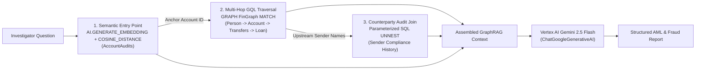

# Anti-Money Laundering (AML) Detection with BigQuery GraphRAG & Vertex AI

[](https://www.python.org/)
[](https://cloud.google.com/bigquery)
[](https://cloud.google.com/vertex-ai)
[](https://python.langchain.com/)

An end-to-end **Hybrid GraphRAG** pipeline for financial crime and Anti-Money Laundering (AML) investigations, built entirely on **Google BigQuery** (Vector Search + ISO GQL Property Graphs), **Vertex AI Gemini**, and **LangChain**.

---

## Why GraphRAG for Anti-Money Laundering?

Standard vector-only RAG retrieves isolated text chunks based on semantic similarity, which falls short in AML investigations where illicit behavior is hidden across **multi-hop transaction networks**:

* **Unstructured risk signals** (compliance flags, KYC notes, shell-company warnings) live inside free-text audit logs.
* **Layering and fund-flow topology** (who owns an account, who wired funds into it, and which loan that account repaid) live inside relational/graph edges.

By combining **BigQuery Vector Search** (`AI.GENERATE_EMBEDDING` + `COSINE_DISTANCE`) with **BigQuery Property Graphs** (`GRAPH ... MATCH`), this project resolves vague natural-language investigator questions into a concrete starting entity, traverses multi-hop money flows natively in SQL/GQL, cross-references upstream counterparty audit histories, and synthesizes an actionable compliance report—**with zero ETL to external vector or graph databases**.

---

## System Architecture



### Three-Stage Hybrid Retrieval (`FinGraphRetriever`)

1. **Semantic Entry Point (Vector Search):** Embeds the analyst's natural-language prompt at query time with `AI.GENERATE_EMBEDDING` and ranks `AccountAudits` via `COSINE_DISTANCE` to pinpoint the target account under investigation.
2. **Multi-Hop Fund-Flow Traversal (ISO GQL):** Starting from the matched account node (`a.id = @id`), executes a native BigQuery GQL `MATCH` pattern across `FinGraph`:
   ```sql
   GRAPH `fingraph_rag.FinGraph`
   MATCH
     (sender_person:Person)-[:Owns]->(sender_acc:Account)
     -[tx:Transfers]->
     (a:Account)
     -[repays:Repays]->(l:Loan),
     (owner:Person)-[:Owns]->(a)
   WHERE a.id = @id
   RETURN
     owner.name AS owner_name,
     a.type AS account_type,
     sender_person.name AS sender_name,
     tx.amount AS transfer_amount,
     repays.amount AS repayment_amount,
     l.id AS loan_id
   ```
3. **Upstream Counterparty Enrichment:** Collects unique upstream senders discovered in the graph path and retrieves their compliance audit logs via parameterized `UNNEST(@sender_names)` joins—exposing hidden layering risks such as flagged intermediaries or shell companies funding a seemingly legitimate loan repayment.

---

## Key Engineering Highlights

* **Zero-Data-Movement Architecture:** Runs vector embeddings, cosine similarity search, ISO GQL graph pattern matching, and relational joins inside a single BigQuery dataset (`fingraph_rag`).
* **Modern Unified GenAI SDK (`langchain-google-genai` v4+):** Uses `ChatGoogleGenerativeAI(..., vertexai=True)` backed by Google's unified `google-genai` SDK and Application Default Credentials (ADC), eliminating deprecated `ChatVertexAI` / `vertexai.init()` dependencies.
* **Parameterized Query Safety:** Enforces `bigquery.ScalarQueryParameter` and `bigquery.ArrayQueryParameter` (`UNNEST`) across every SQL and GQL query to prevent SQL injection and safely handle entity names containing special characters.
* **Composable LCEL Pipeline:** Implements a typed custom `BaseRetriever` (`FinGraphRetriever`) wired into a declarative LangChain Expression Language (`LCEL`) chain with structured execution logging.

---

## BigQuery Data & Property Graph Model

| Asset | Type | Purpose |
| :--- | :--- | :--- |
| `Account` | Node Table | Financial accounts (`id`, `create_time`, `is_blocked`, `type`) |
| `Person` | Node Table | Account holders and counterparties (`id`, `name`, ...) |
| `Loan` | Node Table | Issued credit facilities and loans (`id`, `loan_amount`, ...) |
| `PersonOwnAccount` | Edge Table (`:Owns`) | Links `Person` entities to owned `Account` nodes |
| `AccountTransferAccount` | Edge Table (`:Transfers`) | Directed fund transfers (`amount`, timestamp) between accounts |
| `AccountRepayLoan` | Edge Table (`:Repays`) | Loan repayments (`amount`) originating from an `Account` |
| `AccountAudits` | Vector Table | Unstructured compliance notes + `ARRAY<FLOAT64>` `embedding` column |
| `embedding_model` | BQML Remote Model | Vertex AI text-embedding model for `AI.GENERATE_EMBEDDING` |
| `FinGraph` | Property Graph | BigQuery `CREATE PROPERTY GRAPH` definition over the node and edge tables |

---

## Project Structure

```text
Anti-Money-Laundering-GraphRAD/
├── graphrag_aml.py      # Hybrid BigQuery GraphRAG retriever + Vertex AI LCEL pipeline
├── requirements.txt     # Core Python dependencies
├── .gitignore           # Environment, cache, and credential exclusions
└── README.md            # Architecture & setup documentation
```

---

## Getting Started

### 1. Prerequisites
* **Python 3.11+**
* A **Google Cloud Project** with the **BigQuery API**, **BigQuery Connection API**, and **Vertex AI API** enabled
* Provisioned BigQuery dataset (`fingraph_rag`) containing the `FinGraph` property graph, `AccountAudits` vector table, and `embedding_model` remote model
* Local authentication via Google Cloud CLI:
  ```bash
  gcloud auth application-default login
  ```

### 2. Installation

```bash
git clone https://github.com/iPablo26/Anti-Money-Laundering-GraphRAD.git
cd Anti-Money-Laundering-GraphRAD

python3 -m venv venv
source venv/bin/activate
pip install -r requirements.txt
```

### 3. Configuration

`graphrag_aml.py` reads configuration from environment variables with sensible defaults:

```bash
export GCP_PROJECT_ID="your-gcp-project-id"
export GCP_REGION="us-central1"
export BQ_DATASET_ID="fingraph_rag"
export GEMINI_MODEL="gemini-2.5-flash"
```

### 4. Run an Investigation

```bash
python graphrag_aml.py
```

#### Default Investigation Prompt
> *"Why is Menville's loan repayment at risk? Flag any suspicious activity if you notice."*

When executed, the pipeline logs each stage of retrieval (`AccountAudits` vector match → `FinGraph` GQL traversal → upstream sender audit lookup) and outputs a detailed fraud analyst report tracing the origin of funds, intermediary accounts, and compliance flags behind the repayment.

---

## Author

**Peter "Pablo" Okwukogu** — [@iPablo26](https://github.com/iPablo26)
